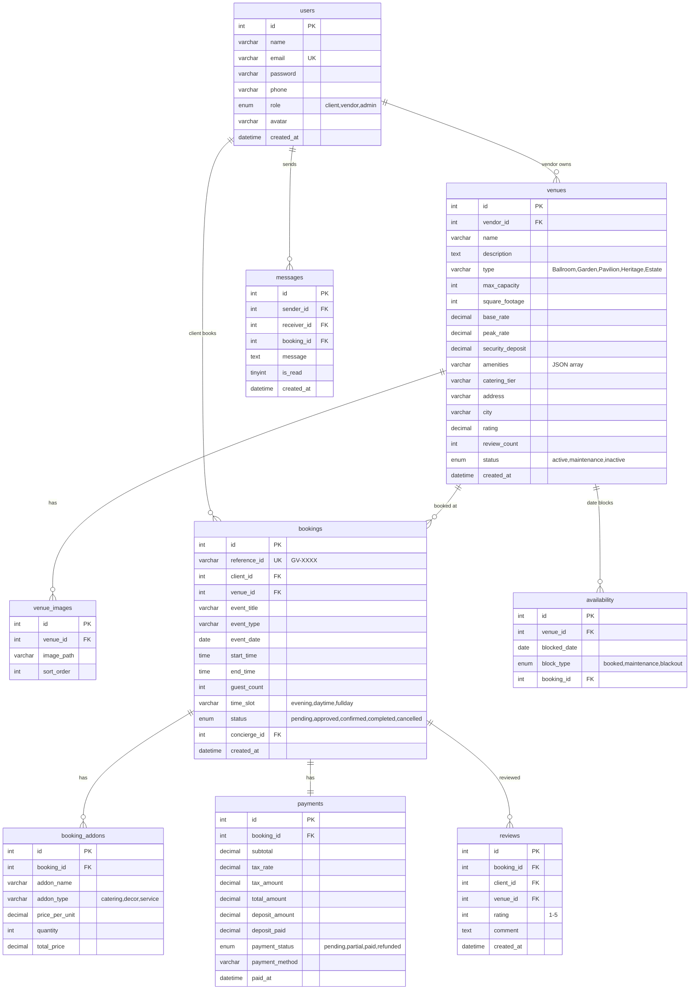

# 🏛️ Banquet Hall Booking System — Complete Development Plan

## 📋 What I Found in Your Stitch Design

Your Stitch project **"Banquet Hall Booking System"** (Brand: **GrandVistas**) has **7 designed screens**:

| # | Screen | Purpose |
|---|--------|---------|
| 1 | **Venue Explorer** | Browse venues with filters (date, capacity, type, price), 6 venue cards with images |
| 2 | **Live Availability & Details** | Single venue view with live calendar, pricing calculator, booking form |
| 3 | **Booking Checkout** | Multi-step checkout: Event Details → Catering Add-ons → Decor Upgrades → Payment |
| 4 | **Dashboard** (Client) | Client portal: active reservations, event timeline, financial ledger, concierge chat |
| 5 | **Vendor Portal** | Venue owner dashboard: revenue metrics, reservation table, rate controls, calendar |
| 6 | **Admin Management** | Admin panel: all bookings, hall status controls, staff concierge logs |
| 7 | **List Your Venue** | Multi-step vendor registration form (5 steps with gallery upload) |

---

## 🛠️ Technology Stack

| Layer | Technology | Why |
|-------|-----------|-----|
| **Backend** | **PHP 8.x** (Native/Procedural + OOP) | Per your request — no framework overhead |
| **Database** | **MySQL 8.0** | Relational data model fits bookings, users, venues perfectly |
| **Frontend** | **HTML5 + Vanilla CSS + JavaScript** | Matches Stitch design (converted from Tailwind to Vanilla CSS) |
| **Typography** | **Google Fonts** (Newsreader + Inter) | From your Stitch design system |
| **Icons** | **Material Symbols Outlined** | From your Stitch design |
| **Server** | **XAMPP / WAMP** (Apache + PHP + MySQL) | Local development on Windows |
| **Sessions** | **PHP Sessions** | User authentication state |
| **File Upload** | **PHP `move_uploaded_file()`** | Venue gallery images |
| **Security** | **PDO Prepared Statements, password_hash, CSRF tokens** | Protection against SQL injection, XSS |
| **PDF Generation** | **FPDF / TCPDF** (optional) | Invoice PDF export from Dashboard |

---

## 🔍 What's in the Stitch Design vs What's Missing

### ✅ Covered in Stitch Design
- Venue browsing with filters & search
- Live availability calendar with date selection
- Dynamic pricing calculator (guests × catering + decor)
- Multi-step booking checkout (4 steps)
- Client dashboard with reservations & timeline
- Vendor portal with reservation management
- Admin panel with all bookings & hall status toggles
- Vendor onboarding (5-step form)
- Concierge messaging UI

### ❌ Missing — Will Be Added for a Complete System

| Feature | Why It's Needed |
|---------|----------------|
| **User Registration & Login** | Authentication for Clients, Vendors, and Admins |
| **Role-Based Access Control (RBAC)** | 3 roles: `client`, `vendor`, `admin` |
| **Database Schema** | Complete MySQL tables for all entities |
| **Email Notifications** | Booking confirmations, status updates via `PHPMailer` |
| **Booking Status Workflow** | Pending → Approved → Confirmed → Completed / Cancelled |
| **Payment Recording** | Store payment info (mock, not real Stripe) with deposit tracking |
| **Search & Filter Backend** | PHP logic for date, capacity, type, price filtering |
| **Image Upload System** | Venue photo upload with filesystem storage |
| **Invoice Generation** | PHP-generated invoices (HTML or PDF) |
| **Contact/Enquiry Form** | General enquiry page for non-registered users |
| **Reviews & Ratings** | Client reviews after event completion |
| **Responsive Navigation** | Mobile hamburger menu (Stitch shows desktop only) |

---

## 🗄️ Database Schema (MySQL)



---

## 📁 Project File Structure

```
d:\MCA\SEM - 1\WDOS\BanquetHall\
│
├── config/
│   └── database.php              # PDO MySQL connection
│
├── includes/
│   ├── header.php                 # Common header + navbar
│   ├── footer.php                 # Common footer
│   ├── sidebar.php                # Dashboard sidebar (vendor/admin)
│   ├── auth_check.php             # Session auth middleware
│   └── functions.php              # Helper functions (CSRF, sanitize, etc.)
│
├── assets/
│   ├── css/
│   │   └── style.css              # Complete design system (from Stitch)
│   ├── js/
│   │   ├── calendar.js            # Live availability calendar
│   │   ├── pricing.js             # Dynamic pricing calculator
│   │   └── main.js                # General interactions
│   ├── images/
│   │   ├── logo.png               # GrandVistas logo
│   │   └── venues/                # Uploaded venue photos
│   └── fonts/                     # (Google Fonts via CDN)
│
├── auth/
│   ├── login.php                  # Login page + processing
│   ├── register.php               # Registration (role selection)
│   ├── logout.php                 # Session destroy
│   └── forgot_password.php        # Password reset
│
├── pages/
│   ├── index.php                  # Homepage / Landing
│   ├── venues.php                 # Venue Explorer (browse + filter)
│   ├── venue_detail.php           # Single Venue + Live Availability
│   ├── checkout.php               # Multi-step Booking Checkout
│   ├── contact.php                # Contact / Enquiry form
│   └── about.php                  # About Us page
│
├── client/
│   ├── dashboard.php              # Client Dashboard
│   ├── my_bookings.php            # My Reservations list
│   ├── booking_detail.php         # Single booking detail
│   ├── messages.php               # Concierge messaging
│   └── profile.php                # Edit profile
│
├── vendor/
│   ├── dashboard.php              # Vendor Portal (metrics + table)
│   ├── manage_venue.php           # Edit venue details
│   ├── availability.php           # Calendar + blackout management
│   ├── bookings.php               # Reservation management
│   ├── rates.php                  # Rate & surcharge controls
│   └── register_venue.php         # List Your Venue (5-step form)
│
├── admin/
│   ├── dashboard.php              # Admin Management Portal
│   ├── bookings.php               # All bookings (filter/search/paginate)
│   ├── venues.php                 # All venues + status toggles
│   ├── users.php                  # User management
│   ├── concierge_log.php          # Staff assignment log
│   └── reports.php                # Revenue reports + export
│
├── api/
│   ├── check_availability.php     # AJAX: check date availability
│   ├── calculate_price.php        # AJAX: pricing calculator
│   ├── update_booking_status.php  # AJAX: approve/reject booking
│   └── send_message.php           # AJAX: concierge messaging
│
├── sql/
│   └── banquet_hall.sql           # Complete MySQL schema + seed data
│
└── index.php                      # Entry point (redirect to pages/index.php)
```

## ✅ Bug Fixes and Local Image Upload Implementation

### Booking date field

- The preferred-date field in the dark reservation panel now uses an explicit light color scheme.
- Its label, entered date, placeholder, and calendar icon remain readable against the panel and input background.
- The same date styling applies anywhere a date field is used inside a dark price/summary panel.

### Vendor venue images

- Vendor registration now uses a multipart image upload instead of requiring an external image URL.
- Accepted formats are JPG, PNG, and WebP, with a 5 MB size limit.
- Files are stored in `uploads/venues/` with generated filenames; executable file types are blocked by `.htaccess`.
- A shared `image_url()` helper supports both existing remote seed images and newly uploaded local images.
- Venue cards, venue details, and client booking details all resolve local paths through the helper, so uploaded images are visible to clients.

### Validation checklist

1. Sign in as a vendor and submit a venue with a valid image.
2. Confirm a generated file appears under `uploads/venues/`.
3. Open the venue explorer and venue detail page as a client; verify the uploaded cover image displays.
4. Open a booking detail page; verify the same venue image displays there.
5. Open a venue detail page and verify the preferred-date field has readable text and calendar controls.

## Booking Status and Email Notifications

- Hall partners can change a booking to Pending, Approved, Confirmed, or Cancelled.
- The client dashboard and booking details always read the current status from the `bookings.status` field.
- A new booking request sends an email to the hall partner's registered email address.
- A changed booking status sends an email to the client's registered email address.
- Email delivery uses Gmail SMTP. Copy `.env.example` to `.env`, then enter the Gmail address and Google App Password in `MAIL_USERNAME` and `MAIL_PASSWORD`. Never commit `.env`; it is ignored by `.gitignore`.
- The vendor booking dashboard now uses a clean list view without booking references. Each booking has its own status badge and status editor for Pending, Approved, Confirmed, or Cancelled.

### Gmail SMTP setup

1. Enable 2-Step Verification on the Gmail/Google account.
2. Create a Google App Password for this application.
3. Copy `.env.example` to `.env` in the project root.
4. Set `MAIL_USERNAME` to the Gmail address and `MAIL_PASSWORD` to the 16-character App Password without spaces.
5. Keep `MAIL_FROM_ADDRESS` equal to the authenticated Gmail address.

---

## 🚀 Development Phases

### Phase 1: Foundation (Core Setup)
- [x] Analyze Stitch design ✅
- [ ] Create MySQL database schema (`banquet_hall.sql`)
- [ ] Set up `config/database.php` (PDO connection)
- [ ] Create `includes/` (header, footer, functions, auth)
- [ ] Build `assets/css/style.css` (design system from Stitch)
- [ ] Build authentication system (login, register, logout)

### Phase 2: Public Pages (Client-Facing)
- [ ] Homepage / Landing page (`pages/index.php`)
- [ ] Venue Explorer with search & filters (`pages/venues.php`)
- [ ] Venue Detail with live calendar (`pages/venue_detail.php`)
- [ ] Booking Checkout multi-step form (`pages/checkout.php`)
- [ ] Contact page (`pages/contact.php`)

### Phase 3: Client Dashboard
- [ ] Client dashboard with reservation cards
- [ ] Booking detail view
- [ ] Event timeline
- [ ] Financial ledger / payment status
- [ ] Concierge messaging

### Phase 4: Vendor Portal
- [ ] Vendor dashboard with revenue metrics
- [ ] Reservation management table
- [ ] Rate & surcharge controls
- [ ] Live availability calendar + blackout dates
- [ ] Venue registration form (5-step)

### Phase 5: Admin Panel
- [ ] Admin dashboard with global metrics
- [ ] All bookings management (filter, search, paginate)
- [ ] Hall status controls (active/maintenance toggles)
- [ ] Staff concierge assignment log
- [ ] User management
- [ ] Revenue reports & CSV export

### Phase 6: Polish & Extras
- [ ] Email notifications (PHPMailer)
- [ ] Reviews & ratings system
- [ ] Invoice PDF generation
- [ ] Mobile responsive navigation
- [ ] Input validation & CSRF protection
- [ ] Error pages (404, 403)

---

## 🎨 Design System Summary (From Stitch)

| Token | Value |
|-------|-------|
| **Primary** | `#000805` (Deep Emerald-Black) |
| **Primary Container** | `#0A231C` (Rich Emerald) |
| **Secondary** | `#735C00` (Champagne Gold) |
| **Secondary Container** | `#FED65B` (Bright Gold) |
| **Surface** | `#FBF9F5` (Warm Cream) |
| **Error** | `#BA1A1A` |
| **Headline Font** | Newsreader (serif) |
| **Body Font** | Inter (sans-serif) |
| **Border Radius** | 0.125rem – 0.75rem (subtle, formal) |
| **Spacing Scale** | xs: 0.375rem → xl: 4rem |

---

> [!IMPORTANT]
> This plan covers everything from your Stitch design **plus** all the missing backend functionality needed for a production-ready system. The system uses **PHP + MySQL** as requested — no frameworks, keeping it lean and educational for your MCA semester project.

> [!TIP]
> If you want, I can start building this phase by phase. I recommend starting with **Phase 1 (Foundation)** — creating the database, config, and authentication system first.
